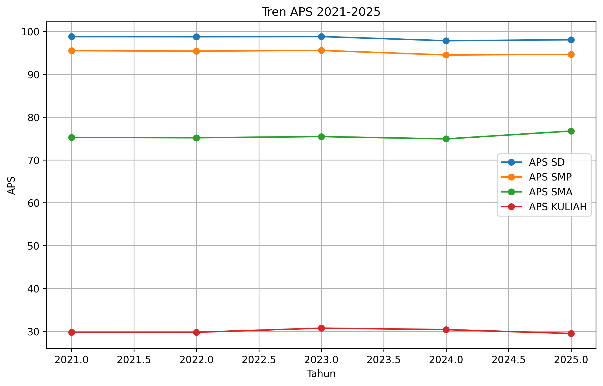
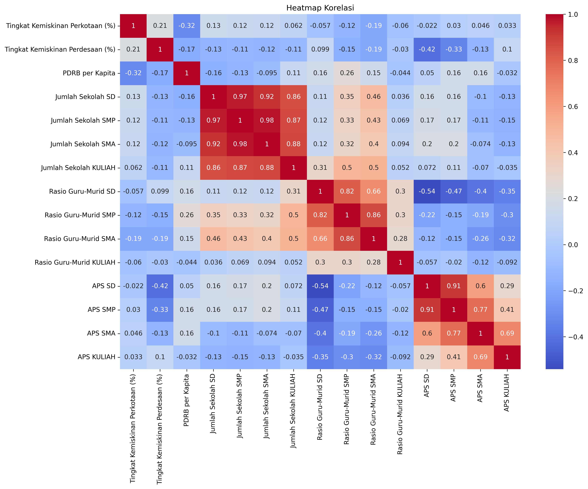

# School Participation Rate (APS) Analysis

A collaborative semester project exploring school participation rates (*Angka Partisipasi Sekolah*, APS) in Indonesia from 2021 to 2025.

## Project overview

The analysis combines exploratory data analysis with two modeling approaches:

- Random Forest regression to estimate APS for SD, SMP, SMA, and higher education.
- A linear trend baseline to project APS from 2026 to 2030.

The model inputs include poverty rates, GRDP per capita, school counts, and teacher-to-student ratios. The included workbook is the input dataset; the project code identifies its source as BPS.

## Selected findings

APS varies substantially by education level, while the included correlation analysis shows strong relationships among school-count variables. These are exploratory associations, not evidence that one factor causes a change in APS.





## Run locally

Requirements: Python 3.10 or later.

```powershell
py -m venv .venv
.\.venv\Scripts\Activate.ps1
py -m pip install -r requirements.txt
py prediksi.py
```

The script reads `aps_indonesia_2021_2025.xlsx` from the project folder. It saves charts to `figures/` and the forecast workbook to `outputs/`.

## Method and limitations

- Random Forest metrics use a random train/test split. Because observations span multiple years, this evaluation does not establish how well the model predicts future years.
- The dataset covers five years, so the 2026–2030 linear trend is a simple baseline and should not be treated as an official forecast.
- Correlations and Random Forest feature importances are not causal explanations.
- Add the exact BPS publication or dataset URL and access date before redistributing the dataset or presenting results publicly.

## Project files

- `prediksi.py` — data cleaning, exploratory analysis, model evaluation, and trend forecasting.
- `aps_indonesia_2021_2025.xlsx` — input dataset.
- `figures/` — selected charts generated by the analysis.
- `outputs/aps_forecasts_2026_2030.xlsx` — forecast results by education level.
#
